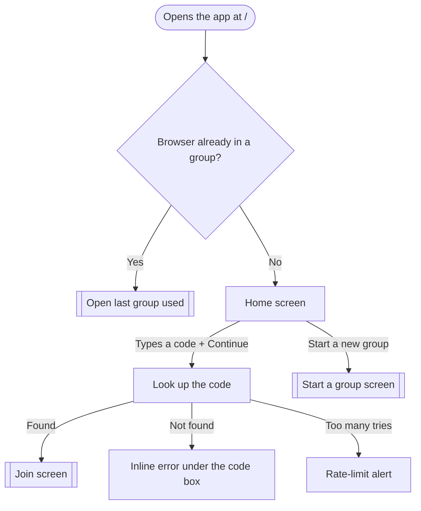
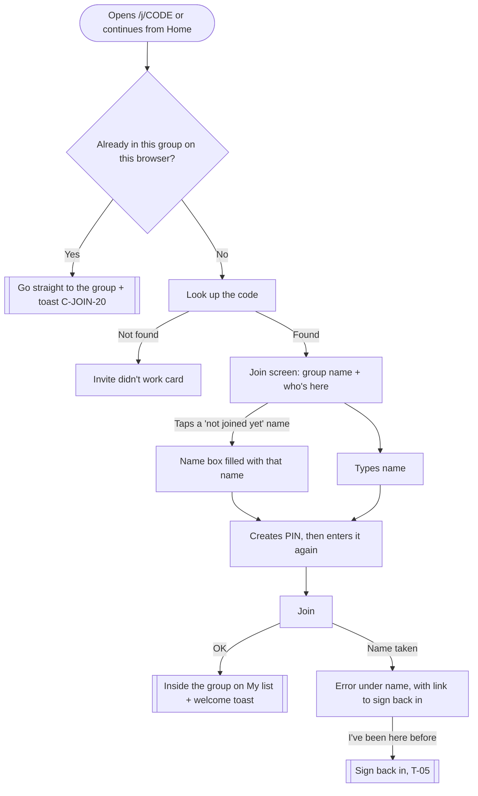

# UI Interaction Maps

| | |
|---|---|
| **Status** | Section 1 (Getting in) is DRAFT v0.1, awaiting TPM review. Other sections follow. |
| **Last updated** | 2026-11-21 |
| **Branch** | `claude/sharp-knuth-889h6a-ui-workflow` |
| **Design language** | shadcn/ui (ADR-15) |
| **Task IDs** | From `UI_TASK_MAP.md` |
| **Build approach** | APIs and UI built together, screen by screen (G18) |

**How to read a map.** Each task has:
1. a **flow** diagram;
2. **screens**: a text wireframe at phone width (360 px), with the shadcn component for each element in `code`;
3. a **wording table**: every piece of text on screen, word for word, each with an ID (`C-…`). In the code, all text lives in one file (`src/web/copy.ts`) under these same IDs, so wording can be reviewed and changed in one place;
4. an **API and errors table**: which call each step makes, and what the person sees for each possible error;
5. **accessibility notes**.

Wording uses the **recommended L-labels** from `UI_TASK_MAP.md` §6. If you change an L-label, every matching `C-` entry changes with it.

---

# Section 1: Getting in (T-01 to T-08, S-02 to S-04, S-06)

## 1.0 Screens in this section

| Screen | Address | Shown when |
|---|---|---|
| **Home** | `/` | The browser isn't in any group yet. *If it is, `/` opens the last group used instead.* |
| **Join** | `/j/<code>`, or after entering a code on Home | Someone has a group code |
| **Start a group** | `/new` | Someone taps "Start a new group" |
| **Waiting** | `/new` (same address, after sending) | A request has been sent and isn't decided yet |

Shared layout: one centred `Card`, at most 420 px wide. App name at the top. No tabs, because the person isn't in a group yet.

---

## 1.1 Home screen: T-02 (type a code), entry to T-05 and T-06

### Flow


### Screen
```
┌────────────────────────────────────┐
│  🎁 Gift Lists                     │  ← heading (h1)
│  Share wish lists with family and  │
│  friends. No accounts. No          │
│  passwords.                        │  ← muted text
│                                    │
│ ┌ Card ──────────────────────────┐ │
│ │ Have a group code?             │ │  ← CardTitle
│ │ Group code                     │ │  ← Label
│ │ ┌────────────────────────────┐ │ │
│ │ │ K7QM-4XTR                  │ │ │  ← Input (placeholder)
│ │ └────────────────────────────┘ │ │
│ │ Got an invite link? Just open  │ │
│ │ it. It fills this in for you.  │ │  ← helper text
│ │ [        Continue         ]    │ │  ← Button (primary, full width)
│ └────────────────────────────────┘ │
│                                    │
│ ─────────── or ───────────         │  ← Separator
│ [     Start a new group      ]     │  ← Button (outline, full width)
└────────────────────────────────────┘
```

### Wording
| ID | Element | Text |
|---|---|---|
| C-HOME-01 | Page title (browser tab) | Gift Lists |
| C-HOME-02 | Heading | Gift Lists |
| C-HOME-03 | Intro | Share wish lists with family and friends. No accounts. No passwords. |
| C-HOME-04 | Card title | Have a group code? |
| C-HOME-05 | Field label | Group code |
| C-HOME-06 | Placeholder | K7QM-4XTR |
| C-HOME-07 | Helper | Got an invite link? Just open it. It fills this in for you. |
| C-HOME-08 | Button | Continue |
| C-HOME-09 | Button while working | Checking… |
| C-HOME-10 | Divider | or |
| C-HOME-11 | Button | Start a new group |
| C-HOME-12 | Error: empty code | Enter the code you were given. |

### API and errors
| Step | Call | Result | What the person sees |
|---|---|---|---|
| Continue | `POST /api/groups/lookup {code}` | 200 | Join screen for that group |
| | | 400 `invalid_code` | Under the box: **C-ERR-CODE** |
| | | 429 `rate_limited` | **C-ERR-RATE** alert above the card; Continue disabled until the wait is over |
| | | No connection | **C-ERR-OFFLINE** toast |

### Accessibility
- The code box uses `autocapitalize="characters"`, `autocomplete="off"` and `inputmode="text"`. Lowercase and the dash are accepted anyway.
- Errors are linked to the box with `aria-describedby` and announced through an `aria-live` region. Focus returns to the box after an error.
- Buttons are at least 44 px tall.

---

## 1.2 Join screen: T-01 (invite link), T-03 (new person), T-04 (pre-added name)

### Flow


### Screen
```
┌────────────────────────────────────┐
│ ← Back                             │  ← Button (ghost, small)
│ ┌ Card ──────────────────────────┐ │
│ │ Join Smith Family              │ │  ← CardTitle
│ │ Already here: Sam, Alex, Jo    │ │
│ │ and 2 more                     │ │  ← CardDescription
│ │                                │ │
│ │ Is one of these you?           │ │  ← only if pre-added names exist
│ │ (Grandma) (Uncle Ray)          │ │  ← Badge buttons (outline)
│ │                                │ │
│ │ Your name                      │ │  ← Label
│ │ ┌────────────────────────────┐ │ │
│ │ │                            │ │ │  ← Input
│ │ └────────────────────────────┘ │ │
│ │ This is how others in the      │ │
│ │ group will see you.            │ │  ← helper
│ │                                │ │
│ │ Create a PIN                   │ │  ← Label
│ │ [ ][ ][ ][ ][ ][ ]             │ │  ← InputOTP, 6 slots
│ │ 4 to 6 numbers.                │ │  ← helper
│ │ ┌ Alert (info) ──────────────┐ │ │
│ │ │ You won't need this PIN    │ │ │
│ │ │ every time. You'll only    │ │ │
│ │ │ need it if you open your   │ │ │
│ │ │ list on another device, or │ │ │
│ │ │ after clearing your        │ │ │
│ │ │ browser's cookies or cache.│ │ │  ← FR-1.6
│ │ └────────────────────────────┘ │ │
│ │ Enter your PIN again           │ │
│ │ [ ][ ][ ][ ][ ][ ]             │ │  ← InputOTP
│ │                                │ │
│ │ [   Join Smith Family     ]    │ │  ← Button (primary)
│ │                                │ │
│ │ Been here before? Sign back in │ │  ← Button (link)
│ └────────────────────────────────┘ │
└────────────────────────────────────┘
```

**Why "enter your PIN again":** the PIN is only needed rarely, and a typo would lock the person out of their own name later. Typing it twice costs a few seconds now and saves a support call later. *(Decision G24.)*

### Wording
| ID | Element | Text |
|---|---|---|
| C-JOIN-01 | Back link | Back |
| C-JOIN-02 | Title | Join {groupName} |
| C-JOIN-03 | Who's here (1–3 names) | Already here: {name1}, {name2} and {name3} |
| C-JOIN-04 | Who's here (more than 3) | Already here: {name1}, {name2}, {name3} and {n} more |
| C-JOIN-05 | Who's here (nobody yet) | You're the first one here. |
| C-JOIN-06 | Pre-added names heading | Is one of these you? |
| C-JOIN-07 | Pre-added names helper | The group organiser added these names. Tap yours to use it. |
| C-JOIN-08 | Name label | Your name |
| C-JOIN-09 | Name helper | This is how others in the group will see you. |
| C-JOIN-10 | PIN label | Create a PIN |
| C-JOIN-11 | PIN helper | 4 to 6 numbers. |
| C-JOIN-12 | PIN explanation (FR-1.6) | You won't need this PIN every time. You'll only need it if you open your list on another device, or after clearing your browser's cookies or cache. |
| C-JOIN-13 | Confirm label | Enter your PIN again |
| C-JOIN-14 | Button | Join {groupName} |
| C-JOIN-15 | Button while working | Joining… |
| C-JOIN-16 | Switch to recovery | Been here before? Sign back in |
| C-JOIN-17 | Error: PINs differ | The two PINs don't match. Try again. |
| C-JOIN-18 | Error: name empty | Enter your name. |
| C-JOIN-19 | Welcome toast | Welcome to {groupName}! |
| C-JOIN-20 | Already-a-member toast | You're already in {groupName}. |
| C-JOIN-21 | Bad invite: title | This invite didn't work |
| C-JOIN-22 | Bad invite: body | The link may be mistyped or out of date. Ask the person who sent it for a new one, or enter a group code. |
| C-JOIN-23 | Bad invite: button | Enter a code |
| C-ERR-NAME-TAKEN | Error under name (from API) | Someone in this group already uses that name. If it's you, sign back in instead. |
| C-ERR-NAME-TAKEN-LINK | Link inside that error | Sign back in |

### API and errors
| Step | Call | Result | What the person sees |
|---|---|---|---|
| Page opens | `GET /api/me` | Already a member | Goes straight in, with toast **C-JOIN-20** |
| Page opens | `POST /api/groups/lookup {code}` | 200 | The join form |
| | | 400 `invalid_code` | The "This invite didn't work" card (**C-JOIN-21 to C-JOIN-23**) |
| | | 429 `rate_limited` | **C-ERR-RATE** |
| Join | `POST /api/join {code, displayName, pin}` | 201 | Into the group's "My list", with toast **C-JOIN-19** |
| | | 409 `name_taken` | Under the name: **C-ERR-NAME-TAKEN**, with a **Sign back in** link that opens recovery with the name filled in |
| | | 400 `validation` | Under the matching field: the API's message |
| | | 429 `rate_limited` | **C-ERR-RATE** |

Checked in the browser before sending: name not empty (**C-JOIN-18**), PIN is 4–6 numbers (**C-JOIN-11**), and both PINs match (**C-JOIN-17**).

### Accessibility
- `InputOTP` has the label "PIN, 4 to 6 numbers" and a numeric keypad (`inputmode="numeric"`). It accepts pasting.
- Pre-added names are real buttons. Tapping one fills the name box and moves focus to the PIN.
- The info alert uses `role="note"`, not an alarming style.

---

## 1.3 Sign back in: T-05 (and S-02 lockout, S-04 browser forgot me)

### Flow


### Screen
```
┌────────────────────────────────────┐
│ ← Back                             │
│ ┌ Card ──────────────────────────┐ │
│ │ Welcome back to Smith Family   │ │  ← CardTitle
│ │ Pick your name and enter your  │ │
│ │ PIN.                           │ │  ← CardDescription
│ │ Your name                      │ │
│ │ ┌──────────────────────────┐ ▾ │ │  ← Select (joined members only)
│ │ │ Choose your name         │   │ │
│ │ └──────────────────────────┘   │ │
│ │ PIN                            │ │
│ │ [ ][ ][ ][ ][ ][ ]             │ │  ← InputOTP
│ │ [        Sign in          ]    │ │  ← Button (primary)
│ │ Forgot your PIN? Ask the group │ │
│ │ organiser to reset it.         │ │  ← muted text
│ │ New here? Join instead         │ │  ← Button (link)
│ └────────────────────────────────┘ │
└────────────────────────────────────┘
```

### Wording
| ID | Element | Text |
|---|---|---|
| C-REC-01 | Title | Welcome back to {groupName} |
| C-REC-02 | Description | Pick your name and enter your PIN. |
| C-REC-03 | Name label | Your name |
| C-REC-04 | Select placeholder | Choose your name |
| C-REC-05 | PIN label | PIN |
| C-REC-06 | Button | Sign in |
| C-REC-07 | Button while working | Signing in… |
| C-REC-08 | Forgot PIN | Forgot your PIN? Ask the group organiser to reset it. |
| C-REC-09 | Switch to join | New here? Join instead |
| C-REC-10 | Error: no name chosen | Choose your name from the list. |
| C-REC-11 | After a PIN reset (shown if the server accepted a new PIN) | Your PIN was reset, so the PIN you just entered is now your new PIN. |
| C-REC-12 | Success toast | Welcome back, {name}! |
| C-ERR-CREDENTIALS | Wrong PIN | That name and PIN didn't match. Check them and try again. After 5 wrong tries, your name is locked for 15 minutes. |
| C-ERR-LOCKED-TITLE | Locked alert title | Too many wrong PINs |
| C-ERR-LOCKED-BODY | Locked alert body | For safety, {name} is locked until {time}. Try again then, or ask the group organiser to reset your PIN. |

**Why we show the 5-try rule up front:** it's honest, it helps a person slow down, and it gives an attacker nothing they couldn't find out anyway.

### API and errors
| Step | Call | Result | What the person sees |
|---|---|---|---|
| Page opens | `POST /api/groups/lookup {code}` (reused from the Join screen) | 200 | Name list of joined members only |
| Sign in | `POST /api/recover {code, displayName, pin}` | 200 | Into the group, with toast **C-REC-12** |
| | | 401 `invalid_credentials` | **C-ERR-CREDENTIALS**, PIN boxes cleared, focus on the PIN |
| | | 423 `locked` | **C-ERR-LOCKED** alert with the end time (from `Retry-After`). Sign in disabled until then. |
| | | 429 `rate_limited` | **C-ERR-RATE** |

**API change needed (small):** after an admin PIN reset, the server accepts the PIN entered as the new one. The response should say so (`{pinWasReset: true}`), so the screen can show **C-REC-11**. *(Decision G25.)*

### S-04: the browser forgot who they are
If someone clears their cookies, the app opens on **Home**. Their invite link or code takes them to the Join screen, where the **Sign back in** link is shown. The name-taken error (**C-ERR-NAME-TAKEN**) also points them there if they try to join again under their own name.

---

## 1.4 Start a group: T-06 (ask), T-07 (wait), T-08 (declined)

### Flow


### Screen: request form
```
┌────────────────────────────────────┐
│ ← Back                             │
│ ┌ Card ──────────────────────────┐ │
│ │ Start a new group              │ │  ← CardTitle
│ │ Tell us about your group. The  │ │
│ │ app's organiser approves new   │ │
│ │ groups.                        │ │  ← CardDescription
│ │ Group name                     │ │
│ │ ┌────────────────────────────┐ │ │
│ │ │ e.g. Smith Family          │ │ │  ← Input
│ │ └────────────────────────────┘ │ │
│ │ Currency                       │ │
│ │ ┌──────────────────────────┐ ▾ │ │  ← Select (default from device region)
│ │ │ US dollar (USD)          │   │ │
│ │ └──────────────────────────┘   │ │
│ │ Used when a price doesn't say. │ │  ← helper
│ │ Your name                      │ │
│ │ ┌────────────────────────────┐ │ │
│ │ └────────────────────────────┘ │ │
│ │ Create a PIN / Enter it again  │ │  ← same as the Join screen
│ │ (PIN explanation alert)        │ │
│ │ [      Send request       ]    │ │
│ └────────────────────────────────┘ │
└────────────────────────────────────┘
```

### Screen: waiting
```
┌────────────────────────────────────┐
│ ┌ Card ──────────────────────────┐ │
│ │ ⏳ Waiting for approval        │ │  ← CardTitle with icon
│ │ We'll move you into "Smith     │ │
│ │ Family" as soon as it's        │ │
│ │ approved.                      │ │
│ │ ┌ Alert ─────────────────────┐ │ │
│ │ │ You can close this page.   │ │ │
│ │ │ Come back on this same     │ │ │
│ │ │ phone or computer to get   │ │ │
│ │ │ in.                        │ │ │
│ │ └────────────────────────────┘ │ │
│ │ Last checked: just now         │ │  ← muted
│ │ [       Check now         ]    │ │  ← Button (outline)
│ └────────────────────────────────┘ │
└────────────────────────────────────┘
```

### Wording
| ID | Element | Text |
|---|---|---|
| C-NEW-01 | Title | Start a new group |
| C-NEW-02 | Description | Tell us about your group. The app's organiser approves new groups. |
| C-NEW-03 | Group name label | Group name |
| C-NEW-04 | Group name placeholder | e.g. Smith Family |
| C-NEW-05 | Currency label | Currency |
| C-NEW-06 | Currency helper | Used when a price doesn't say. |
| C-NEW-07 | Your name label | Your name |
| C-NEW-08 | Button | Send request |
| C-NEW-09 | Button while working | Sending… |
| C-NEW-10 | Waiting title | Waiting for approval |
| C-NEW-11 | Waiting body | We'll move you into "{groupName}" as soon as it's approved. |
| C-NEW-12 | Waiting note | You can close this page. Come back on this same phone or computer to get in. |
| C-NEW-13 | Last checked | Last checked: {relativeTime} |
| C-NEW-14 | Button | Check now |
| C-NEW-15 | Declined title | Your request wasn't approved |
| C-NEW-16 | Declined body | Your request for "{groupName}" wasn't approved. If you think this is a mistake, contact the app's organiser. |
| C-NEW-17 | Declined button | Send a new request |
| C-NEW-18 | Error: group name empty | Enter a name for your group. |
| C-NEW-19 | Error: group name too long | Group names can be up to 60 characters. |
| C-NEW-20 | Approved toast | "{groupName}" is ready. Welcome! |

PIN, name and PIN-explanation wording is reused from the Join screen (**C-JOIN-08 to C-JOIN-13, C-JOIN-17, C-JOIN-18**).

### API and errors (these endpoints are new, built with this screen)
| Step | Call | Result | What the person sees |
|---|---|---|---|
| Send request | `POST /api/group-requests {groupName, currency, displayName, pin}` | 201, sets the `r_<id>` cookie | Waiting screen |
| | | 400 `validation` | Under the matching field |
| | | 429 `rate_limited` | **C-ERR-RATE** |
| Waiting (every 30 s, plus "Check now") | `GET /api/group-requests/current` | `pending` | Stay; update "Last checked" |
| | | `approved` | The server swaps the request cookie for a member cookie. The person moves into the group, with toast **C-NEW-20**. |
| | | `declined` | Declined message (**C-NEW-15 to C-NEW-17**) |
| | | No request cookie | Home screen |

### Accessibility
- Waiting status changes are announced through `aria-live="polite"`.
- Automatic checks pause while the tab is hidden (ADR-07).

---

## 1.5 Shared messages for this section

| ID | When | Text | Component |
|---|---|---|---|
| C-ERR-CODE | Unknown or mistyped code | That group code didn't work. Check it and try again. | Error text under the field |
| C-ERR-RATE | Too many attempts (S-03) | Too many attempts. Please wait {minutes} minutes and try again. | `Alert` (destructive) |
| C-ERR-OFFLINE | No connection (S-06) | You're offline. Check your connection and try again. | `Sonner` toast |
| C-ERR-SERVER | Unexpected error (S-07) | Something went wrong. Please try again. | `Sonner` toast |
| C-ERR-CSRF | Blocked request (shouldn't happen in normal use) | This request was blocked for security reasons. Refresh the page and try again. | `Sonner` toast |

---

## 1.6 Open points from this section

| # | Point | Proposed |
|---|---|---|
| G24 | Ask for the PIN twice when creating it? | **Yes.** It prevents typos that would lock a person out later. |
| G25 | After an admin PIN reset, tell the person their entered PIN is now the new one? | **Yes.** Add `pinWasReset: true` to the recovery response and show **C-REC-11**. |
| G26 | What do members call the admin on screen? | **"the group organiser"** (in v1, the app's single admin). Used in C-JOIN-07, C-REC-08 and C-NEW-02. |
| G27 | Currency default when requesting a group | Guess from the device's region, e.g. en-US → USD, en-GB → GBP. The person can change it. Show the 10 most common currencies first. |
| G28 | Show the 5-try lockout rule in the wrong-PIN message? | **Yes** (see C-ERR-CREDENTIALS). |

---

## 1.7 Tests for this section

These are added to TEST_PLAN.md when the section is approved.

| ID | Test | Type |
|---|---|---|
| UI-01 | Home: entering a valid code opens the Join screen with the group name | E2E |
| UI-02 | Home: an invalid code shows C-ERR-CODE, with focus returned to the box | E2E |
| UI-03 | `/j/<code>` opens the Join screen directly; an already-joined browser goes straight in | E2E |
| UI-04 | Join as a new person → lands on My list with the welcome toast (part of success criterion 2) | E2E |
| UI-05 | Tapping a pre-added name fills it in; joining uses that member | E2E |
| UI-06 | Name taken → error with a working "Sign back in" link | E2E |
| UI-07 | PINs that don't match are caught before sending | E2E |
| UI-08 | Sign back in on a second browser (part of success criterion 3) | E2E |
| UI-09 | Wrong PIN message; the 5th wrong PIN shows the locked alert with an end time | E2E |
| UI-10 | Request a group → waiting → admin approves → moved in automatically | E2E + API (REQ-01 to REQ-03) |
| UI-11 | Declined request → message → "Send a new request" | E2E + API (REQ-04) |
| UI-12 | Phone width 360 px: no sideways scrolling on any screen in this section | E2E (NFR-1) |
| UI-13 | Every visible text in this section comes from `copy.ts` and matches the IDs above | Unit |
| UI-14 | Keyboard only: every screen can be completed with Tab and Enter; errors are announced | E2E (accessibility) |
