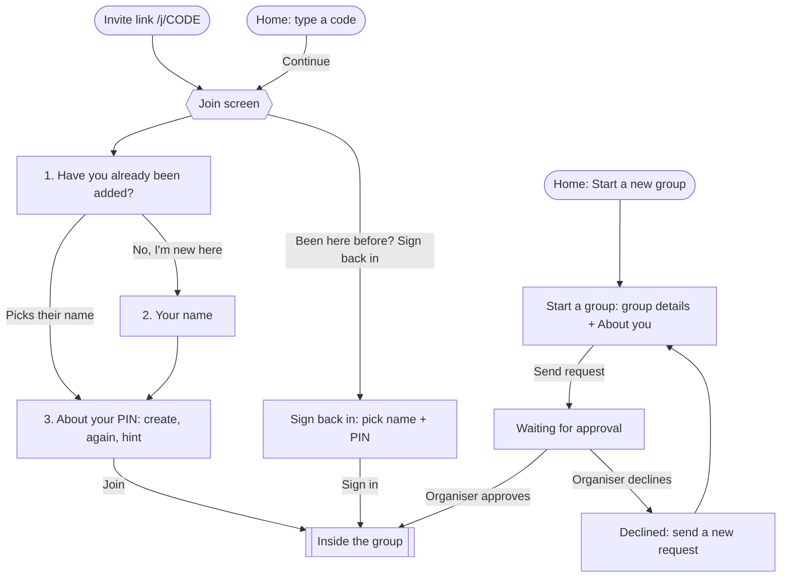
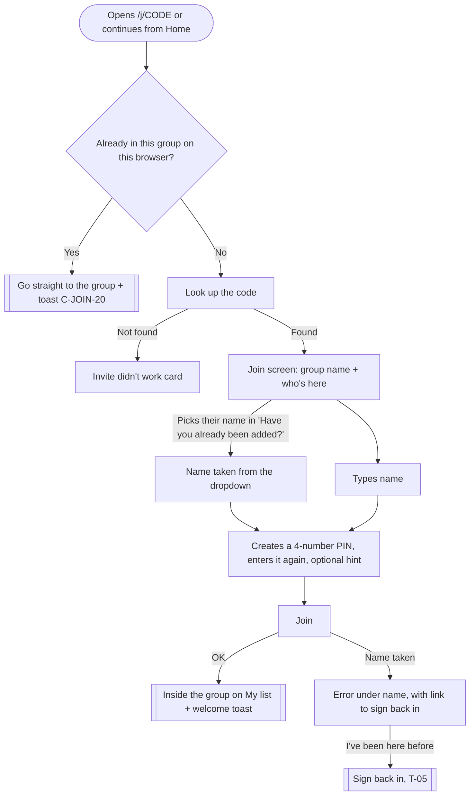
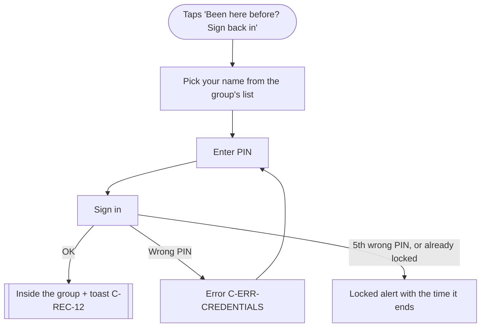
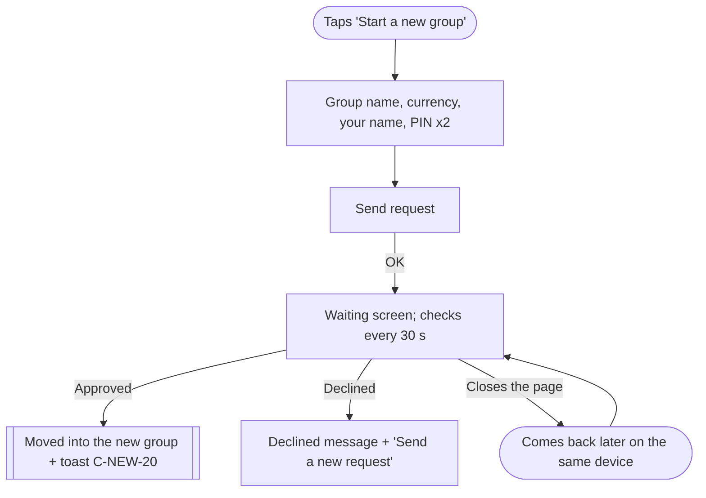

# UI Interaction Maps

| | |
|---|---|
| **Status** | Section 1 (Getting in) v0.3: **built, with review round 1 changes applied** (2026-11-21) and awaiting TPM feedback. Screenshots are in `docs/screens/section-1/`. Feedback updates this document and the UI together; test UI-13 fails if the two disagree. Other sections follow. |
| **Last updated** | 2026-11-21 |
| **Branch** | `claude/sharp-knuth-889h6a-ui-workflow` |
| **Design language** | shadcn/ui (ADR-15) |
| **Task IDs** | From `UI_TASK_MAP.md` |
| **Build approach** | APIs and UI built together, screen by screen (G18) |

**How to read a map.** Each task has:
1. a **flow** diagram;
2. **screens**: a text wireframe at phone width (360 px), with the shadcn component for each element in `code`;
3. a **wording table**: every piece of text on screen, word for word, each with an ID (`C-…`). In the code, all text lives in one file (`src/web/copy.ts`) under these same IDs, so wording can be reviewed and changed in one place;
4. an **API and errors table**: which call each step makes, and what the person sees for each possible error;
5. **accessibility notes**.

Wording uses the **recommended L-labels** from `UI_TASK_MAP.md` §6. If you change an L-label, every matching `C-` entry changes with it.

---

# Section 1: Getting in (T-01 to T-08, S-02 to S-04, S-06)

## 1.00 Global rules for every Getting-in screen and scenario *(added in TPM review round 2)*

**Why:** in round 2 the TPM found that scenarios didn't follow one shared logic. The same screen looked different from one scenario to the next because of data the tester couldn't see. Errors appeared at different moments, and one dropdown didn't open in the viewer. These rules apply to **every** screen and scenario in this section. Later sections will get their own global rules in the same form.

### One flow for all scenarios (GR-1)
Every scenario is a path through this one map. No scenario has a step that isn't on it.



### Same screen, same layout (GR-2)
- **The Join screen always has the same blocks, in the same order,** whatever the group's data:
  1. Title and "Already here"
  2. **Have you already been added?** This is **always shown**. It lists the names the organiser added who haven't signed in yet, then "No, I'm new here". If nobody is waiting, the only option is "No, I'm new here", and it's already chosen (G32).
  3. **Your name**, shown only after "No, I'm new here" is chosen.
  4. **About your PIN**: Create a PIN, the PIN explanation, Enter your PIN again, and the optional PIN hint. Shown once step 2 is answered.
  5. The **Join** button, then the **Been here before? Sign back in** link.
- **Start a new group** uses exactly the same "Your name" field and **About your PIN** block, in the same order, with the same wording and the same checks.
- **Sign back in** uses the same name picker and PIN boxes as Join.

### When problems are shown (GR-3)
| What | When it's checked | Where it shows |
|---|---|---|
| Required text (name, group name, code) | When you leave the field, and when you tap the main button | Red text right under the field |
| PIN length (4 numbers) | When you leave the PIN boxes, and on the main button | Under the PIN boxes |
| **PINs match** | **The moment the 4th number is typed** in "Enter your PIN again". A mismatch shows straight away; a match shows "PINs match." | Under "Enter your PIN again" |
| Hint contains the PIN | As you type the hint | Under the hint |
| Unanswered "Have you already been added?" | When you tap Join | Under the dropdown |
| Server checks (wrong code, name taken, wrong PIN) | When you tap the main button | Under the field they belong to |
| Blocking problems (locked, too many attempts) | When they happen | Red alert above the card; main button disabled |

An error clears as soon as the field it belongs to is changed. Main buttons stay enabled, so tapping them always shows what's missing, except during blocking problems.

### Dropdowns (GR-4)
Every dropdown uses the **phone's own picker** (a styled native `select`), so it opens on any device and inside any viewer. This applies to: Have you already been added?, Your name on Sign back in, and Currency.

### Layout and feedback (GR-5, GR-6, GR-7)
- **GR-5:** Every screen except Home has **Back** at the top left. Each screen is one card. The main button spans the full width at the bottom of the card, with any secondary link under it.
- **GR-6:** Success messages appear briefly at the top of the screen. Field problems show in red under the field. Blocking problems show as a red alert above the card. Explanations show in a grey info box.
- **GR-7:** After you choose from a dropdown, focus moves to the next field. After an error, focus moves to the first field with a problem.

### Prototype data (GR-8)
Every scenario uses **the same Smith Family group** (code `SMTH-2345`):

| Member | State | PIN | Hint |
|---|---|---|---|
| Sam | Joined | 1234 | the old house number |
| Alex | Joined | 1234 | none |
| Jo | Joined | 2580 | the garden gate |
| Grandma | Added by the organiser, hasn't signed in | — | — |
| Uncle Ray | Added by the organiser, hasn't signed in | — | — |

Scenarios differ only in **how the person arrives** and **what this browser already knows**, for example new, already signed in, or holding a group request. Each scenario card shows both.


## 1.0 Screens in this section

| Screen | Address | Shown when |
|---|---|---|
| **Home** | `/` | The browser isn't in any group yet. *If it is, `/` opens the last group used instead.* |
| **Join** | `/j/<code>`, or after entering a code on Home | Someone has a group code |
| **Start a group** | `/new` | Someone taps "Start a new group" |
| **Waiting** | `/new` (same address, after sending) | A request has been sent and isn't decided yet |

Shared layout: one centred `Card`, at most 420 px wide. App name at the top. No tabs, because the person isn't in a group yet.

---

## 1.1 Home screen: T-02 (type a code), entry to T-05 and T-06

### Flow


### Screen *(revised in TPM review round 1)*
```
┌────────────────────────────────────┐
│                                    │  ← header line, kept empty for future use
│ ┌ Card ──────────────────────────┐ │
│ │ Group code                     │ │  ← Label
│ │ ┌────────────────────────────┐ │ │
│ │ │ K7QM-4XTR                  │ │ │  ← Input (placeholder)
│ │ └────────────────────────────┘ │ │
│ │ Got an invite link? Just open  │ │
│ │ it. It fills this in for you.  │ │  ← helper text
│ │ [        Continue         ]    │ │  ← Button (primary, full width)
│ └────────────────────────────────┘ │
│ ─────────── or ───────────         │  ← Separator
│ [     Start a new group      ]     │  ← Button (outline, full width)
└────────────────────────────────────┘
```

### Wording
| ID | Element | Text |
|---|---|---|
| C-HOME-01 | Page title (browser tab) | Gift Lists |
| C-HOME-05 | Field label | Group code |
| C-HOME-06 | Placeholder | K7QM-4XTR |
| C-HOME-07 | Helper | Got an invite link? Just open it. It fills this in for you. |
| C-HOME-08 | Button | Continue |
| C-HOME-09 | Button while working | Checking… |
| C-HOME-10 | Divider | or |
| C-HOME-11 | Button | Start a new group |
| C-HOME-12 | Error: empty code | Enter the code you were given. |

*Removed in review round 1: C-HOME-02 ("Gift Lists" heading), C-HOME-03 (intro line) and C-HOME-04 ("Have a group code?"). These IDs won't be reused.*

### API and errors
| Step | Call | Result | What the person sees |
|---|---|---|---|
| Continue | `POST /api/groups/lookup {code}` | 200 | Join screen for that group |
| | | 400 `invalid_code` | Under the box: **C-ERR-CODE** |
| | | 429 `rate_limited` | **C-ERR-RATE** alert above the card; Continue disabled until the wait is over |
| | | No connection | **C-ERR-OFFLINE** toast |

### Accessibility
- The code box uses `autocapitalize="characters"`, `autocomplete="off"` and `inputmode="text"`. Lowercase and the dash are accepted anyway.
- Errors are linked to the box with `aria-describedby` and announced through an `aria-live` region. Focus returns to the box after an error.
- Buttons are at least 44 px tall.

---

## 1.2 Join screen: T-01 (invite link), T-03 (new person), T-04 (pre-added name)

### Flow


### Screen *(revised in TPM review round 1)*
```
┌────────────────────────────────────┐
│ ← Back                             │  ← Button (ghost, small)
│ ┌ Card ──────────────────────────┐ │
│ │ Join Smith Family              │ │  ← CardTitle
│ │ Already here: Sam, Alex, Jo    │ │
│ │ and 2 more                     │ │  ← CardDescription
│ │                                │ │
│ │ Have you already been added?   │ │  ← Label (only if not-yet-joined names exist)
│ │ ┌──────────────────────────┐ ▾ │ │  ← Select: not-yet-joined names
│ │ │ Choose your name         │   │ │     + "No, I'm new here"
│ │ └──────────────────────────┘   │ │
│ │ If the group organiser already │ │
│ │ added your name, choose it     │ │
│ │ here.                          │ │  ← helper
│ │                                │ │
│ │ Your name                      │ │  ← hidden once a listed name is chosen
│ │ ┌────────────────────────────┐ │ │
│ │ └────────────────────────────┘ │ │  ← Input
│ │ This is how others in the      │ │
│ │ group will see you.            │ │
│ │                                │ │
│ │ Create a PIN                   │ │
│ │ [ 1 ][ 2 ][ 3 ][ 4 ]           │ │  ← InputOTP, 4 slots, numbers visible
│ │ 4 numbers.                     │ │
│ │ (PIN explanation alert)        │ │  ← FR-1.6, unchanged
│ │ Enter your PIN again           │ │
│ │ [ 1 ][ 2 ][ 3 ][ 4 ]           │ │
│ │ PIN hint (optional)            │ │  ← Input, max 40 characters
│ │ ┌────────────────────────────┐ │ │
│ │ └────────────────────────────┘ │ │
│ │ A reminder only you will       │ │
│ │ understand. Don't include your │ │
│ │ PIN.                           │ │
│ │ [   Join Smith Family     ]    │ │  ← Button (primary; long names wrap)
│ │ Been here before? Sign back in │ │  ← Button (link)
│ └────────────────────────────────┘ │
└────────────────────────────────────┘
```

**Revised again in review round 2 (global rules GR-2, GR-3, GR-4):** the dropdown is always shown and is answered first. "Your name" appears only after "No, I'm new here". The PIN block appears once the dropdown is answered. Both dropdowns use the phone's own picker. The PIN match is checked the moment the 4th number is typed.

**How people get here:** by opening an invite link (`/j/<code>`), or by entering a code on Home.

**Who appears in the dropdown:** only names the organiser added that haven't signed in for the first time yet. As soon as someone signs in under a name, it disappears from the dropdown. If nobody is waiting, the dropdown still appears (GR-2), with "No, I'm new here" as its only option, already chosen (G32).

**Why "enter your PIN again":** the PIN is only needed rarely, and a typo would lock the person out of their own name later. Typing it twice costs a few seconds now and saves a support call later. *(Decision G24.)*

### Wording
| ID | Element | Text |
|---|---|---|
| C-JOIN-01 | Back link | Back |
| C-JOIN-02 | Title | Join {groupName} |
| C-JOIN-03 | Who's here (1–3 names; {names} reads like "Sam, Alex and Jo") | Already here: {names} |
| C-JOIN-04 | Who's here (more than 3; {names} is the first three) | Already here: {names} and {n} more |
| C-JOIN-05 | Who's here (nobody yet) | You're the first one here. |
| C-JOIN-06 | Pre-added names dropdown label | Have you already been added? |
| C-JOIN-07 | Pre-added names helper | If the group organiser already added your name, choose it here. |
| C-JOIN-08 | Name label | Your name |
| C-JOIN-09 | Name helper | This is how others in the group will see you. |
| C-JOIN-10 | PIN label | Create a PIN |
| C-JOIN-11 | PIN helper | 4 numbers. |
| C-JOIN-12 | PIN explanation (FR-1.6) | You won't need this PIN every time. You'll only need it if you open your list on another device, or after clearing your browser's cookies or cache. |
| C-JOIN-13 | Confirm label | Enter your PIN again |
| C-JOIN-14 | Button | Join {groupName} |
| C-JOIN-15 | Button while working | Joining… |
| C-JOIN-16 | Switch to recovery | Been here before? Sign back in |
| C-JOIN-17 | Error: PINs differ (shown the moment the 4th number of the second PIN is typed, GR-3) | The two PINs don't match. Try again. |
| C-JOIN-18 | Error: name empty | Enter your name. |
| C-JOIN-19 | Welcome toast | Welcome to {groupName}! |
| C-JOIN-20 | Already-a-member toast | You're already in {groupName}. |
| C-JOIN-21 | Bad invite: title | This invite didn't work |
| C-JOIN-22 | Bad invite: body | The link may be mistyped or out of date. Ask the person who sent it for a new one, or enter a group code. |
| C-JOIN-23 | Bad invite: button | Enter a code |
| C-JOIN-24 | Dropdown placeholder | Choose your name |
| C-JOIN-25 | Dropdown option for new people | No, I'm new here |
| C-JOIN-26 | Hint label | PIN hint (optional) |
| C-JOIN-27 | Hint helper | A reminder only you will understand. Don't include your PIN. |
| C-JOIN-28 | Error: hint contains the PIN (shown as you type) | Your hint can't include your PIN. |
| C-JOIN-29 | Error: "Have you already been added?" not answered | Choose your name, or "No, I'm new here". |
| C-JOIN-30 | Confirmation the moment both PINs match | PINs match. |
| C-JOIN-31 | Error: second PIN incomplete when tapping Join | Enter your PIN again. |
| C-ERR-NAME-TAKEN | Error under name (from API) | Someone in this group already uses that name. If it's you, sign back in instead. |
| C-ERR-NAME-TAKEN-LINK | Link inside that error | Sign back in |

### API and errors
| Step | Call | Result | What the person sees |
|---|---|---|---|
| Page opens | `GET /api/me` | Already a member | Goes straight in, with toast **C-JOIN-20** |
| Page opens | `POST /api/groups/lookup {code}` | 200 | The join form |
| | | 400 `invalid_code` | The "This invite didn't work" card (**C-JOIN-21 to C-JOIN-23**) |
| | | 429 `rate_limited` | **C-ERR-RATE** |
| Join | `POST /api/join {code, displayName, pin, pinHint?}` | 201 | Into the group's "My list", with toast **C-JOIN-19** |
| | | 409 `name_taken` | Under the name: **C-ERR-NAME-TAKEN**, with a **Sign back in** link that opens recovery with the name filled in |
| | | 400 `validation` | Under the matching field: the API's message |
| | | 429 `rate_limited` | **C-ERR-RATE** |

Checked in the browser, at the moments set by GR-3: dropdown answered (**C-JOIN-29**), name not empty (**C-JOIN-18**), PIN is 4 numbers (**C-JOIN-11**), second PIN complete (**C-JOIN-31**) and matching (**C-JOIN-17** / **C-JOIN-30**), and the hint doesn't contain the PIN (**C-JOIN-28**).

### Accessibility
- `InputOTP` has the label "PIN, 4 numbers" and a numeric keypad (`inputmode="numeric"`). It accepts pasting. Numbers are shown as typed (TPM review round 1).
- The pre-added names dropdown is a standard Select: keyboard and screen-reader friendly. Choosing a name moves focus to the PIN.
- The info alert uses `role="note"`, not an alarming style.

---

### How people reach the error states (scenarios for frames 06 and 07)
| Frame | Scenario that triggers it | What happens next |
|---|---|---|
| **06 PINs don't match** | While joining, the person types one PIN in "Create a PIN" and a different one in "Enter your PIN again", usually a typo. | The second box clears and they retype it. Nothing is sent until both match. |
| **07 This invite didn't work** | The person opens an invite link whose code is wrong: a link copied only partly, mistyped by hand, or (once code rotation exists, B-002) an old link. | "Enter a code" takes them to Home to type the right code, or they ask the sender for a new link. |

## 1.3 Sign back in: T-05 (and S-02 lockout, S-04 browser forgot me)

### Flow


### Screen *(revised in TPM review round 1)*
```
┌────────────────────────────────────┐
│ ← Back                             │
│ ┌ Card ──────────────────────────┐ │
│ │ Welcome back to Smith Family   │ │  ← CardTitle
│ │ Pick your name and enter your  │ │
│ │ PIN.                           │ │  ← CardDescription
│ │ Your name                      │ │
│ │ ┌──────────────────────────┐ ▾ │ │  ← Select (joined members only)
│ │ │ Choose your name         │   │ │
│ │ └──────────────────────────┘   │ │
│ │ PIN                            │ │
│ │ [  ][  ][  ][  ]               │ │  ← InputOTP, 4 slots
│ │ Show my hint                   │ │  ← Button (link), once a name is chosen
│ │ [        Sign in          ]    │ │  ← Button (primary)
│ │ Forgot your PIN? Ask the group │ │
│ │ organiser to reset it.         │ │
│ │ New here? Join instead         │ │  ← Button (link)
│ └────────────────────────────────┘ │
└────────────────────────────────────┘
```

**How people get here (scenario for frame 08):** someone who **already joined** opens the app on a **different phone or computer**, or after **clearing their browser's cookies**, so the app no longer recognises them. They open the invite link or enter the code. On the Join screen they tap **"Been here before? Sign back in"**. They can also arrive from the name-taken error (frame 05) when they try to join again under their own name. People using their usual device never see this screen: the app remembers them.

### Wording
| ID | Element | Text |
|---|---|---|
| C-REC-01 | Title | Welcome back to {groupName} |
| C-REC-02 | Description | Pick your name and enter your PIN. |
| C-REC-03 | Name label | Your name |
| C-REC-04 | Select placeholder | Choose your name |
| C-REC-05 | PIN label | PIN |
| C-REC-06 | Button | Sign in |
| C-REC-07 | Button while working | Signing in… |
| C-REC-08 | Forgot PIN | Forgot your PIN? Ask the group organiser to reset it. |
| C-REC-09 | Switch to join | New here? Join instead |
| C-REC-10 | Error: no name chosen | Choose your name from the list. |
| C-REC-11 | After a PIN reset (shown if the server accepted a new PIN) | Your PIN was reset, so the PIN you just entered is now your new PIN. |
| C-REC-12 | Success toast | Welcome back, {name}! |
| C-REC-13 | Link, after a name is chosen | Show my hint |
| C-REC-14 | The hint | Your hint: {hint} |
| C-REC-15 | No hint was set | You didn't set a hint. |
| C-ERR-CREDENTIALS | Wrong PIN | That name and PIN didn't match. Check them and try again. After 5 wrong tries, your name is locked for 15 minutes. |
| C-ERR-LOCKED-TITLE | Locked alert title | Too many wrong PINs |
| C-ERR-LOCKED-BODY | Locked alert body | For safety, {name} is locked until {time}. Try again then, or ask the group organiser to reset your PIN. |

**Why we show the 5-try rule up front:** it's honest, it helps a person slow down, and it gives an attacker nothing they couldn't find out anyway.

### API and errors
| Step | Call | Result | What the person sees |
|---|---|---|---|
| Page opens | `POST /api/groups/lookup {code}` (reused from the Join screen) | 200 | Name list of joined members only |
| Show my hint | `POST /api/groups/hint {code, displayName}` | 200 | **C-REC-14**, or **C-REC-15** if there's no hint |
| Sign in | `POST /api/recover {code, displayName, pin}` | 200 | Into the group, with toast **C-REC-12** |
| | | 401 `invalid_credentials` | **C-ERR-CREDENTIALS**, PIN boxes cleared, focus on the PIN |
| | | 423 `locked` | **C-ERR-LOCKED** alert with the end time (from `Retry-After`). Sign in disabled until then. |
| | | 429 `rate_limited` | **C-ERR-RATE** |

**API change needed (small):** after an admin PIN reset, the server accepts the PIN entered as the new one. The response should say so (`{pinWasReset: true}`), so the screen can show **C-REC-11**. *(Decision G25.)*

### S-04: the browser forgot who they are
If someone clears their cookies, the app opens on **Home**. Their invite link or code takes them to the Join screen, where the **Sign back in** link is shown. The name-taken error (**C-ERR-NAME-TAKEN**) also points them there if they try to join again under their own name.

---

## 1.4 Start a group: T-06 (ask), T-07 (wait), T-08 (declined)

### Flow


### Screen: request form
```
┌────────────────────────────────────┐
│ ← Back                             │
│ ┌ Card ──────────────────────────┐ │
│ │ Start a new group              │ │  ← CardTitle
│ │ Tell us about your group. The  │ │
│ │ app's organiser approves new   │ │
│ │ groups.                        │ │  ← CardDescription
│ │ Group name                     │ │
│ │ ┌────────────────────────────┐ │ │
│ │ │ e.g. Smith Family          │ │ │  ← Input
│ │ └────────────────────────────┘ │ │
│ │ Currency                       │ │
│ │ ┌──────────────────────────┐ ▾ │ │  ← Select (default from device region)
│ │ │ US dollar (USD)          │   │ │
│ │ └──────────────────────────┘   │ │
│ │ Used when a price doesn't say. │ │  ← helper
│ │ Your name                      │ │
│ │ ┌────────────────────────────┐ │ │
│ │ └────────────────────────────┘ │ │
│ │ Create a PIN / Enter it again  │ │  ← same as the Join screen (4 numbers)
│ │ (PIN explanation alert)        │ │
│ │ PIN hint (optional)            │ │  ← same as the Join screen
│ │ [      Send request       ]    │ │
│ └────────────────────────────────┘ │
└────────────────────────────────────┘
```

### Screen: waiting
```
┌────────────────────────────────────┐
│ ┌ Card ──────────────────────────┐ │
│ │ ⏳ Waiting for approval        │ │  ← CardTitle with icon
│ │ We'll move you into "Smith     │ │
│ │ Family" as soon as it's        │ │
│ │ approved.                      │ │
│ │ ┌ Alert ─────────────────────┐ │ │
│ │ │ You can close this page.   │ │ │
│ │ │ Come back on this same     │ │ │
│ │ │ phone or computer to get   │ │ │
│ │ │ in.                        │ │ │
│ │ └────────────────────────────┘ │ │
│ │ Last checked: just now         │ │  ← muted
│ │ [       Check now         ]    │ │  ← Button (outline)
│ └────────────────────────────────┘ │
└────────────────────────────────────┘
```

### Wording
| ID | Element | Text |
|---|---|---|
| C-NEW-01 | Title | Start a new group |
| C-NEW-02 | Description | Tell us about your group. The app's organiser approves new groups. |
| C-NEW-03 | Group name label | Group name |
| C-NEW-04 | Group name placeholder | e.g. Smith Family |
| C-NEW-05 | Currency label | Currency |
| C-NEW-06 | Currency helper | Used when a price doesn't say. |
| C-NEW-07 | Your name label | Your name |
| C-NEW-08 | Button | Send request |
| C-NEW-09 | Button while working | Sending… |
| C-NEW-10 | Waiting title | Waiting for approval |
| C-NEW-11 | Waiting body | We'll move you into "{groupName}" as soon as it's approved. |
| C-NEW-12 | Waiting note | You can close this page. Come back on this same phone or computer to get in. |
| C-NEW-13 | Last checked ({time} reads like "just now" or "5 minutes ago") | Last checked: {time} |
| C-NEW-14 | Button | Check now |
| C-NEW-15 | Declined title | Your request wasn't approved |
| C-NEW-16 | Declined body | Your request for "{groupName}" wasn't approved. If you think this is a mistake, contact the app's organiser. |
| C-NEW-17 | Declined button | Send a new request |
| C-NEW-18 | Error: group name empty | Enter a name for your group. |
| C-NEW-19 | Error: group name too long | Group names can be up to 60 characters. |
| C-NEW-20 | Approved toast | "{groupName}" is ready. Welcome! |

PIN, hint, name and PIN-explanation wording is reused from the Join screen (**C-JOIN-08 to C-JOIN-13, C-JOIN-17, C-JOIN-18, C-JOIN-26 to C-JOIN-28**).

### API and errors (these endpoints are new, built with this screen)
| Step | Call | Result | What the person sees |
|---|---|---|---|
| Send request | `POST /api/group-requests {groupName, currency, displayName, pin, pinHint?}` | 201, sets the `r_<id>` cookie | Waiting screen |
| | | 400 `validation` | Under the matching field |
| | | 429 `rate_limited` | **C-ERR-RATE** |
| Waiting (every 30 s, plus "Check now") | `GET /api/group-requests/current` | `pending` | Stay; update "Last checked" |
| | | `approved` | The server swaps the request cookie for a member cookie. The person moves into the group, with toast **C-NEW-20**. |
| | | `declined` | Declined message (**C-NEW-15 to C-NEW-17**) |
| | | No request cookie | Home screen |

### Accessibility
- Waiting status changes are announced through `aria-live="polite"`.
- Automatic checks pause while the tab is hidden (ADR-07).

---

## 1.5 Shared messages for this section

| ID | When | Text | Component |
|---|---|---|---|
| C-ERR-CODE | Unknown or mistyped code | That group code didn't work. Check it and try again. | Error text under the field |
| C-ERR-RATE | Too many attempts (S-03) | Too many attempts. Please wait {minutes} minutes and try again. | `Alert` (destructive) |
| C-ERR-OFFLINE | No connection (S-06) | You're offline. Check your connection and try again. | `Sonner` toast |
| C-ERR-SERVER | Unexpected error (S-07) | Something went wrong. Please try again. | `Sonner` toast |
| C-ERR-CSRF | Blocked request (shouldn't happen in normal use) | This request was blocked for security reasons. Refresh the page and try again. | `Sonner` toast |

---

## 1.6 Open points from this section

| # | Point | Proposed |
|---|---|---|
| G24 | Ask for the PIN twice when creating it? | **Yes.** It prevents typos that would lock a person out later. |
| G25 | After an admin PIN reset, tell the person their entered PIN is now the new one? | **Yes.** Add `pinWasReset: true` to the recovery response and show **C-REC-11**. |
| G26 | What do members call the admin on screen? | **"the group organiser"** (in v1, the app's single admin). Used in C-JOIN-07, C-REC-08 and C-NEW-02. |
| G27 | Currency default when requesting a group | Guess from the device's region, e.g. en-US → USD, en-GB → GBP. The person can change it. Show the 10 most common currencies first. |
| G28 | Show the 5-try lockout rule in the wrong-PIN message? | **Yes** (see C-ERR-CREDENTIALS). |

| G29 | PIN hint rules | Optional; up to 40 characters; can't contain the PIN (checked in the browser and on the server); shown on Sign back in only after the person picks their name and taps "Show my hint"; cleared by an admin PIN reset. |
| G30 | **Security trade-off: 4-number PINs and hints** *(needs a TPM decision)* | A 4-number PIN has 10,000 combinations, compared with about 1.1 million for 4–6 numbers. Visible hints can also give clues. Today's limits (5 wrong tries, then 15 minutes locked) let a determined person try about 480 PINs a day against one name, so they'd have about a 50% chance of guessing it within roughly 10 days. **Proposed:** after 3 lockouts in 24 hours, lock the name until the organiser resets the PIN, and tell the organiser. |
| G32 | When nobody is waiting to be added, keep showing "Have you already been added?" | **Yes, with "No, I'm new here" already chosen.** The Join screen always has the same layout (GR-2). *(Built this way; TPM to confirm.)* |
| G31 | The "Already here: Sam, Alex…" line shows the names of people who **have** joined. Keep it, given that the dropdown now only shows people who haven't? | **Keep it.** It confirms the right group, and members see each other's names anyway (FR-1.8). |

**Build note (2026-11-21):** the TPM said "go ahead and build", so G24–G28 and L14–L17 are built with the recommended values above. Any of them can be changed through feedback.

---

## 1.6a Temporary screen: inside a group (until Section 2)

After joining, people land on a simple placeholder until "My list" (Section 2) is mapped and built. It shows the group name, who you're signed in as, and a way to join another group (G20).

| ID | Element | Text |
|---|---|---|
| C-TMP-GROUP-01 | Under the group name | Signed in as {name} |
| C-TMP-GROUP-02 | Body | Your list, everyone's lists and your claims will appear here. These screens come in the next sections of the interaction maps. |
| C-TMP-GROUP-03 | Button | Join another group |

## 1.6b TPM review round 1 (2026-11-21): changes made

| # | Feedback | Change | Where |
|---|---|---|---|
| R1-1 | Frames 01–02: remove the "Gift Lists" heading but keep the header line; remove the intro line; remove "Have a group code?" | Heading text, intro and card title removed. The header line is kept as an empty space for future use. | §1.1; C-HOME-02/03/04 removed |
| R1-2 | How do people reach frames 06–08? | Scenarios written up, with a "How people get here" note on each screen. No UI change. | §1.2 (frames 06, 07), §1.3 (frame 08) |
| R1-3 | Show the PIN numbers; PINs are exactly 4 numbers; add an optional hint | Digits visible; 4 boxes; requirement changed (FR-1.4, NFR-4); hint added (G29) to Join and Start a group, with "Show my hint" on Sign back in | §1.2–§1.4; C-JOIN-11, C-JOIN-26–28, C-REC-13–15; migration 0002 |
| R1-4 | Frames 03–05: dropdown labelled "Have you already been added?"; only list people who haven't signed in for the first time | The name buttons are now a dropdown (plus "No, I'm new here") showing only not-yet-joined names. The requirement is recorded in FR-2.2. | §1.2; C-JOIN-06, C-JOIN-07, C-JOIN-24, C-JOIN-25 |

## 1.6d TPM review round 2 (2026-11-21): changes made

| # | Feedback (prototype results) | Change |
|---|---|---|
| R2-0 | "The prototype doesn't follow any global workflow logic; screens don't share the same design logic." | **Global rules GR-1 to GR-8 added (§1.00)** and applied to every screen and scenario. |
| R2-1 | SC-01: "PINs don't match" should show after the 4th number of the second PIN, not only when Join is tapped | GR-3: live check on the 4th digit, plus "PINs match." The same block is used on Start a group. |
| R2-2 | SC-02 failed (no note) | Likely cause: SC-02's group had nobody waiting to be added, so its Join screen had no dropdown, unlike SC-01 and SC-03. Fixed by GR-2 (dropdown always shown) and GR-8 (one shared group for all scenarios). *TPM to confirm this was the issue.* |
| R2-3 | SC-03: "Have you already been added?" didn't display | GR-4: every dropdown now uses the phone's own picker, which opens reliably inside the viewer. The scenario's steps now match the new layout. |

## 1.6c Clickable prototype and workflow scenarios

**Prototype:** https://claude.ai/artifact/MXW1Uugh9HiZn4ffTukGE7 (private to the TPM). It runs the **real** Section 1 screens in a phone frame against a pretend server inside the page. The pretend server uses the same validation code and messages as the real one. Nothing is sent to Cloudflare.

- **Flag something:** tap any element in the phone to flag a change, question or problem. The flag records the scenario, the screen, the element's text and its **C- wording ID**. "Flag the whole screen" covers layout feedback.
- **Did it match the expected outcome?** Mark each scenario "Works as expected" or "Needs changes", with an optional note. **"Works as expected" puts a green check** on the scenario in the list, and the top bar counts how many of the 12 are working.
- **Global change** (button above the phone): for a change that should apply everywhere the same screen appears. The form shows the scenarios it will affect. Choose **this scenario only**, **every scenario that shows this screen**, or **every screen in the app**. A global change appears in every scenario it affects and is resolved once, for all of them at the same time. If a global change is resolved after a scenario was marked as working, that scenario shows **Re-check** instead of its green check, so it gets tested again with the change in place.
- **Each scenario knows which screens it passes through** (Home, Join, Sign back in, Start a group / Waiting, Inside the group). That's how a global change finds every scenario it affects.
- Flags and results are saved in the artifact's shared storage (`flags` and `runs`), where the engineer reads them. When a flag is resolved, it's marked **Done** with a short resolution.
- **Choosing a scenario:** all 12 are always listed at the top (or on the left on wide screens), grouped by workflow: **Joining a group** (SC-01, 02, 03, 11), **Signing back in** (SC-04, 05, 06), **Starting a new group** (SC-09, 10) and **Mistakes and limits** (SC-07, 08, 12). Previous and Next buttons sit above the phone. *(TPM feedback: at narrower widths the list had collapsed into an easy-to-miss dropdown.)*
- Source: `src/prototype/` (scenarios in `scenarios.ts`). Rebuild with `npm run prototype`.

| Scenario | Workflow | Tasks | What triggers it | Expected outcome |
|---|---|---|---|---|
| SC-01 | Join from an invite link | T-01, T-03 | Someone taps the family's invite link for the first time | Inside the group, with a welcome message |
| SC-02 | Type a group code | T-02 | Someone was told the code out loud | The Join screen for that group |
| SC-03 | Join under a name the organiser added | T-04 | A pre-added person opens the invite | Joined as that name; it leaves the dropdown |
| SC-04 | Name already taken, so sign back in | T-03, T-05 | An existing member tries to join again on a new phone | Back in via "Sign back in" |
| SC-05 | Sign back in on a new device, using the hint | T-05, S-04 | The browser forgot them; they use "Show my hint" | Back in the group |
| SC-06 | Too many wrong PINs | T-05, S-02 | 5 wrong PINs for one name | Locked for 15 minutes; Sign in disabled |
| SC-07 | PIN typo while joining | T-03 | The two PINs don't match | Error; nothing sent (frame 06) |
| SC-08 | Broken invite link | T-01 | A cut-off or mistyped link | "This invite didn't work" → enter a code (frame 07) |
| SC-09 | Start a new group (approved) | T-06, T-07 | No code; asks for a group; the organiser approves | Moved into the new group |
| SC-10 | Start a new group (declined) | T-06, T-08 | The organiser declines | Declined message; can send a new request |
| SC-11 | Open an invite when already in the group | T-01 | A member taps an old invite link | Straight in, "You're already in…" |
| SC-12 | Too many attempts from one network | S-03 | 10 failed attempts from one network | Rate-limit alert; Continue disabled |

## 1.7 Tests for this section

These are added to TEST_PLAN.md when the section is approved.

| ID | Test | Type |
|---|---|---|
| UI-01 | Home: entering a valid code opens the Join screen with the group name | E2E |
| UI-02 | Home: an invalid code shows C-ERR-CODE, with focus returned to the box | E2E |
| UI-03 | `/j/<code>` opens the Join screen directly; an already-joined browser goes straight in | E2E |
| UI-04 | Join as a new person → lands on My list with the welcome toast (part of success criterion 2) | E2E |
| UI-05 | Tapping a pre-added name fills it in; joining uses that member | E2E |
| UI-06 | Name taken → error with a working "Sign back in" link | E2E |
| UI-07 | PINs that don't match are caught before sending | E2E |
| UI-08 | Sign back in on a second browser (part of success criterion 3) | E2E |
| UI-09 | Wrong PIN message; the 5th wrong PIN shows the locked alert with an end time | E2E |
| UI-10 | Request a group → waiting → admin approves → moved in automatically | E2E + API (REQ-01 to REQ-03) |
| UI-11 | Declined request → message → "Send a new request" | E2E + API (REQ-04) |
| UI-12 | Phone width 360 px: no sideways scrolling on any screen in this section | E2E (NFR-1) |
| UI-13 | Every visible text in this section comes from `copy.ts` and matches the IDs above | Unit |
| UI-14 | Keyboard only: every screen can be completed with Tab and Enter; errors are announced | E2E (accessibility) |
