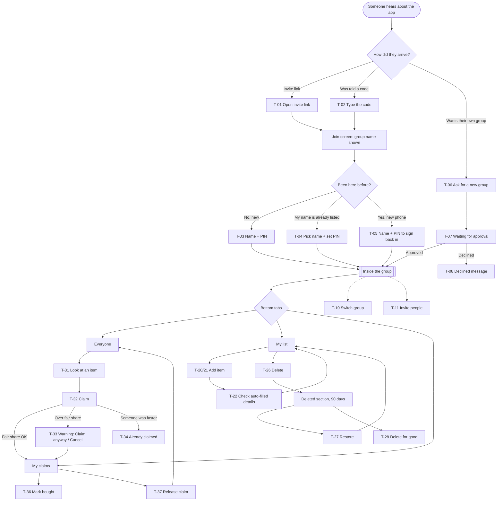
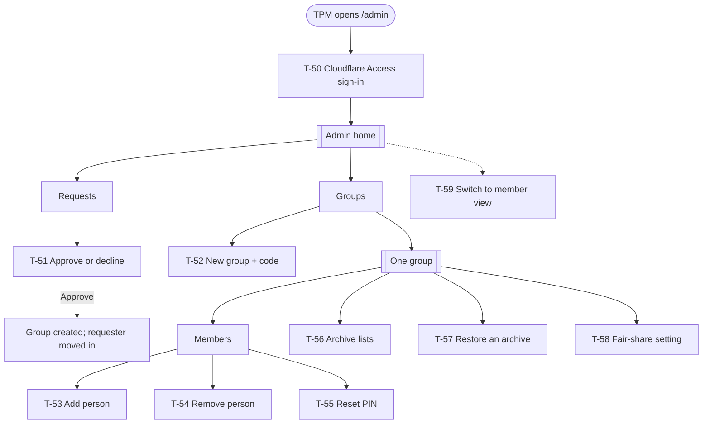
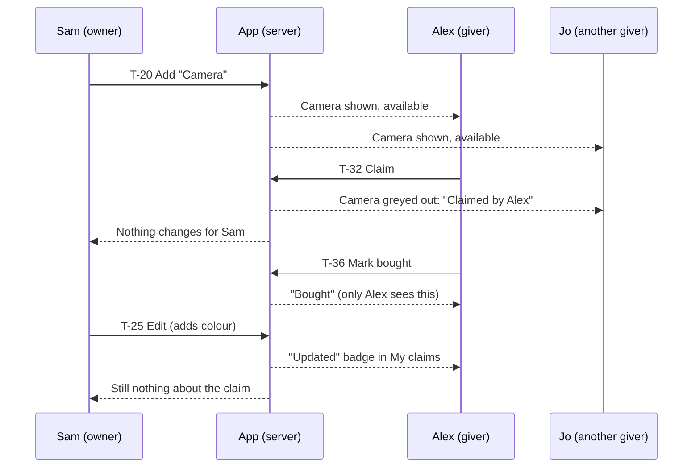

# UI Task Map and Workflow Map

| | |
|---|---|
| **Status** | DRAFT v0.2, awaiting TPM review of L1–L18 and G19–G23 |
| **Last updated** | 2026-11-21 |
| **Branch** | `claude/sharp-knuth-889h6a-ui-workflow` |
| **Design language** | **shadcn/ui** (TPM decision, ADR-15) |
| **Based on** | `PROJECT_BRIEF.md` v1.0, `GLOSSARY.md` (Part D, what each viewer sees), `ARCHITECTURE.md` §7 |

**Order of work (TPM):**
1. **Task map:** every task a person does in the app. *This document, §3.*
2. **Workflow map:** how the tasks connect end to end. *This document, §4–§5.*
3. **Interaction maps:** one per task or feature. Each shows the step-by-step screens, the shadcn components used, and **every label, message and error** for that task. *Next document: `UI_INTERACTION_MAPS.md`, after this one is approved.*
4. Build the UI with shadcn, only after the maps and wording are approved.

---

## 1. Design language: shadcn/ui

shadcn/ui is a set of open-source React components (buttons, cards, dialogs, forms and so on), built on Radix UI for accessibility and styled with Tailwind CSS. The component code is copied into our repo rather than installed as a black-box library, so we own and review every line.

**What this means for the maps:** every screen element is named by its shadcn component, so a design maps directly to code. The components we expect to use:

| Need | shadcn component | Example in our app |
|---|---|---|
| Page sections | `Card` | One card per item; one card per member on the dashboard |
| Main navigation (phone) | `Tabs`, shown as a bottom bar | Everyone / My list / My claims |
| Group switcher | `DropdownMenu` (or `Command` if a person has many groups) | "Smith Family ▾" |
| Text entry | `Form`, `Input`, `Label`, `Textarea` | Name, item title, notes |
| PIN entry | `InputOTP` (one box per digit) | 4–6 digit PIN |
| Choosing an option | `RadioGroup`, `ToggleGroup`, `Select` | Exact product vs Giver's choice; currency |
| Who can see an item | `Checkbox` list in a `Popover` | "Only these people" |
| On/off | `Switch` | "Purchased" |
| Confirmations | `AlertDialog` | Permanently delete; fair-share warning |
| Side panels on phone | `Sheet` (slides up from the bottom) | Add or edit an item |
| Status labels | `Badge` | Claimed, Deleted, Archived, Updated, Pending |
| Inline notices | `Alert` | "Waiting for approval", fair-share nudge |
| Short pop-up messages | `Sonner` (toast) | "Item added", "Link copied" |
| Loading | `Skeleton` | Placeholder cards while the dashboard loads |
| Lists of items | `Accordion` or `Collapsible` | Deleted and Archived sections of my list |
| Admin tables | `Table` | Members, group requests |
| Star | `Toggle` with a star icon (lucide-react) | ☆ / ★ |

**Look and feel (proposed):** shadcn's default "neutral" theme, with light and dark mode following the phone's setting, and one accent colour for primary buttons and stars. Phone-first: designed at 360 px wide first (NFR-1), with larger screens getting more columns, not different screens.

**Packages needed later (access request at build time, not now):** `tailwindcss`, the Radix UI packages for each component, `class-variance-authority`, `clsx`, `tailwind-merge`, `lucide-react` (icons), `sonner` and `input-otp`. Each would go through the ADR-13 rules: exact versions, at least 14 days old, no install scripts, audit clean. I'll list exact versions when we reach the build step.

---

## 2. Roles

| Role | Who | How they arrive |
|---|---|---|
| **Visitor** | Anyone with no group yet | Opens an invite link, types a code, or wants to start a group |
| **Requester** | A visitor who asked for a new group | Submitted "Start a new group" and is waiting for approval |
| **Member, as owner** | A person managing their own wish list | Inside a group, on "My list" |
| **Member, as giver** | The same person shopping for others | Inside a group, on "Everyone" and "My claims" |
| **Admin** | The TPM | Admin protocol from the Claude session (ADR-17); no admin screens for now |
| **System** | Things the app does on its own | Auto-refresh, lockouts, the nightly cleanup |

---

## 3. Task map

Every task a person can do in v1. **IDs (T-xx) are used in the workflow map and the interaction maps.** The "how often" column helps decide what goes on the main screens and what can sit behind a menu.

### 3.1 Getting in (Visitor, Requester)
| ID | Task | Requirement | How often | Starts from | Done when |
|---|---|---|---|---|---|
| T-01 | Open an invite link | FR-1.10 | Once per group | Link in a text or message | Join screen opens with the code filled in |
| T-02 | Type a group code | FR-1.3 | Once per group | Home screen | Join screen shows the group's name |
| T-03 | Join as a new person (name + PIN) | FR-1.3, FR-1.4, FR-1.6 | Once per group | Join screen | Inside the group, on "My list" with an empty-list prompt |
| T-04 | Join under a name the admin already added | FR-2.2 | Once | Join screen ("Is one of these you?") | Inside the group as that person |
| T-05 | Sign back in on a new phone or after clearing the browser | FR-1.7 | Rare | Join screen, "I've been here before" | Inside the group, with their list and claims |
| T-06 | Ask for a new group | FR-1.2 | Rare | Home screen, "Start a new group" | "Waiting for approval" screen |
| T-07 | Wait for approval and get moved in | FR-1.2 | Once | Waiting screen, or returning later | Inside the new group automatically |
| T-08 | Find out a request was declined | FR-1.2 | Rare | Waiting screen | A clear message, with a way to ask again |

### 3.2 Moving around (Member)
| ID | Task | Requirement | How often | Starts from | Done when |
|---|---|---|---|---|---|
| T-10 | Switch to another group | FR-1.9 | Occasional | Group name at the top | The other group's screens are shown |
| T-11 | Invite people | FR-1.2, FR-1.10 | Occasional | "Invite" button | The share menu or "Link copied" |
| T-12 | See who's in the group | FR-1.8 | Occasional | "Everyone" screen | The list of members |
| T-13 | Join another group from inside the app | FR-1.9 | Rare | Group switcher → "Join another group" | Join screen (T-02) |

### 3.3 My list (Member as owner)
| ID | Task | Requirement | How often | Starts from | Done when |
|---|---|---|---|---|---|
| T-20 | Add a specific product ("Exact product") | FR-3.1a | **Frequent** | "My list" → "Add item" | Item appears on my list |
| T-21 | Add an idea with examples ("Giver's choice", up to 5 links) | FR-3.1a, G8 | **Frequent** | "Add item" | Item appears with its example links |
| T-22 | Check and fix auto-filled details | FR-3.1b | With each link | Inside T-20 or T-21 | Details saved; auto-fill status shown |
| T-23 | Choose who can see an item | FR-3.2 | Occasional | Inside the item form | "Everyone" or "Only these people" saved |
| T-24 | Star or unstar an item | FR-3.5 | Frequent | The star on an item card | Star shown to everyone who can see the item |
| T-25 | Edit an item | FR-3.3 | Occasional | Item card → "Edit" | Changes saved (claimers see "Updated") |
| T-26 | Delete an item | FR-7.1 | Occasional | Item card → "Delete" | Item moves to the "Deleted" section for 90 days |
| T-27 | Restore a deleted item | FR-7.1 | Rare | "Deleted" section | Item back on my list |
| T-28 | Delete an item for good | FR-7.2 | Rare | "Deleted" section | Item gone, after a confirmation |
| T-29 | Re-add an archived item | FR-7.3, Q30 | Occasional | "Archived" section | A fresh copy on my list |

### 3.4 Giving (Member as giver)
| ID | Task | Requirement | How often | Starts from | Done when |
|---|---|---|---|---|---|
| T-30 | Browse everyone's lists | FR-4.1 | **Frequent** | "Everyone" screen | Lists shown, grouped by person |
| T-31 | Look at one item and its links | FR-4.1 | **Frequent** | An item card | Details and links shown; links open the retailer site |
| T-32 | Claim an item | FR-5.1 | **Frequent** | Item card → claim button | Item marked as mine; added to "My claims" |
| T-33 | Respond to a fair-share warning | FR-6.4 | Occasional | Inside T-32 | "Claim anyway" or "Cancel" |
| T-34 | Try to claim an item someone just took | NFR-2 | Rare | Inside T-32 | Clear "Someone just claimed this" message; screen refreshes |
| T-35 | Review my claims | FR-5.3 | Frequent | "My claims" screen | Claims grouped by person, sorted by name |
| T-36 | Mark a gift as bought, or undo | FR-5.5 | Frequent | "My claims" | Switch shows "Bought" (only I can see it) |
| T-37 | Release a claim | FR-5.4 | Occasional | "My claims", or the item card | Item available to others again |
| T-38 | See that an item I claimed was changed | FR-5.7 | Occasional | "Updated" badge in "My claims" | Change reviewed; badge cleared |
| T-39 | Deal with an item the owner deleted | FR-7.1, FR-7.2 | Rare | "Deleted by owner" or "No longer on the list" | Kept, released, or dismissed |
| T-40 | Act on a fair-share nudge | FR-6.5 | Rare | Banner on "My claims" | Some claims released, or nudge dismissed for now |

### 3.5 Admin
> **Update 2026-11-21 (ADR-17, G34):** no admin screens for now. Each admin task is done through the **admin protocol** (`ADMIN_PROTOCOL.md`): T-50 is replaced by the admin key; T-51 to T-55 and T-58 are protocol operations (`request.approve` / `request.decline`, `group.create`, `member.add`, `member.remove`, `member.resetPin`, `group.setFairShare`); T-56 and T-57 come as protocol 1.1 once items exist; T-59 isn't needed without an admin area. The tasks below stay as the design for admin screens later (backlog B-017).

| ID | Task | Requirement | How often | Starts from | Done when |
|---|---|---|---|---|---|
| T-50 | Sign in to the admin area | ADR-04 | Occasional | `/admin` | Cloudflare Access sign-in, then admin home |
| T-51 | Approve or decline group requests | FR-2.4 | When requests arrive | Admin home: "Requests" | Request approved (group created) or declined |
| T-52 | Create a group and share its code | FR-2.1 | Rare | Admin: "Groups" → "New group" | Code and invite link shown, ready to copy |
| T-53 | Add a person by name | FR-2.2 | Occasional | Group → "Members" → "Add person" | Person listed as "Not joined yet" |
| T-54 | Remove a person | FR-2.3 | Rare | Group → "Members" | Person removed, after a confirmation that explains the effects |
| T-55 | Reset someone's PIN | FR-2.6 | Rare | Group → "Members" | PIN cleared; they choose a new one next time |
| T-56 | Archive all lists in a group | FR-2.8 | Once a season | Group → "Archive lists" | Everything moved to "Archived", after a confirmation |
| T-57 | Restore an archive | FR-7.4 | Rare | Group → "Archive history" | Items and claims back exactly as before |
| T-58 | Adjust the fair-share setting | G3 | Rare | Group → "Settings" | New buffer value saved |
| T-59 | Switch between admin and member views | FR-2.5 | Occasional | Header link | The other view opens |

### 3.6 Things the app does by itself (System)
| ID | Event | What the person sees |
|---|---|---|
| S-01 | Lists refresh about every 30 seconds | Changes appear quietly; no full-page reload |
| S-02 | Too many wrong PINs | "Locked for 15 minutes" message with a countdown |
| S-03 | Too many attempts from one network | "Too many attempts, wait a few minutes" |
| S-04 | Browser forgot who they are (cookies cleared) | Home screen, with "I've been here before" shown prominently |
| S-05 | An item reaches 90 days in Deleted | It disappears; claimers see "No longer on the list" |
| S-06 | No internet connection | "You're offline. Changes will need a connection." |
| S-07 | Something unexpected went wrong | "Something went wrong. Please try again." |

**Totals:** 8 getting-in tasks, 4 navigation, 10 my list, 11 giving, 10 admin and 7 system events: **50**.

---

## 4. Workflow map: end to end

How a person moves through the app, from first contact to everyday use. Each box is a task (T-xx) or a screen.



### 4.1 Admin workflow



### 4.2 One gift's life, across people

This shows how the surprise rule works across screens: **the owner never sees anything about claims.**



---

## 5. Screen map (information architecture)

```
App
├── Home (no group yet)
│   ├── Enter a code
│   ├── I've been here before
│   └── Start a new group → Waiting for approval
├── Join screen (/j/<code> or after entering a code)
├── Inside a group
│   ├── Top bar: group switcher ▾ · Invite
│   ├── Tab 1: Everyone      (dashboard, one card per person)
│   │     └── Item details (Sheet)
│   ├── Tab 2: My list       (Active · Deleted ▸ · Archived ▸)
│   │     └── Add / edit item (Sheet)
│   └── Tab 3: My claims     (grouped by person · bought · nudges · removed items)
└── Admin (/admin, Cloudflare Access)
    ├── Requests
    ├── Groups → one group → Members · Archive · Settings
    └── Switch to member view
```

**Default tab after joining:** "My list", so a new person adds their first item first (success criterion 2). On later visits the app opens on the last tab used.

---

## 6. Wording decisions needed (L-items)

The glossary uses precise internal terms such as "claim" and "Giver's choice". On screen we may want friendlier words. Each of these labels appears in many places, so it's worth deciding them before the interaction maps. **My recommendation is listed first in each row.**

| # | Concept (glossary term) | Options for the screen | Recommendation and why |
|---|---|---|---|
| L1 | Claim (action) | **"I'll get this"** · "Claim" · "Reserve" | "I'll get this": plain, friendly, and obvious to non-technical relatives |
| L2 | Claimed (status others see) | **"Alex is getting this"** · "Claimed by Alex" · "Reserved" | Matches L1 |
| L3 | Unclaim | **"I'm not getting this"** · "Release" · "Unclaim" | Matches L1; "release" is jargon |
| L4 | Claimed list (tab) | **"My claims"** · "My shopping list" · "Gifts I'm getting" | Short enough for a bottom tab |
| L5 | Dashboard (tab) | **"Everyone"** · "Group" · "Lists" | Short, and says what's there |
| L6 | My list (tab) | **"My list"** · "My wishes" | Clear |
| L7 | Exact product (mode) | **"This exact item"** · "Specific product" | Plain English |
| L8 | Giver's choice (mode) | **"Something like this"** · "Giver's choice" · "Ideas" | Explains itself |
| L9 | Purchased | **"Bought"** · "Purchased" | Shorter; fits a switch |
| L10 | Star | **"Really want"** (tooltip on the ★) · "Favourite" · "Top pick" | Says why it's starred |
| L11 | Soft delete | **"Remove"** (and the section is "Removed, can be restored for 90 days") · "Delete" | "Delete" sounds final; "Remove" fits something that can be undone |
| L12 | Permanent delete | **"Delete forever"** · "Permanently delete" | Clear that it can't be undone |
| L13 | Archive (members see) | **"Last season"** · "Archived" · "Past items" | Friendlier, and matches how archive will be used (between holidays) |
| L14 | Group code | **"Group code"** · "Invite code" | Matches the glossary |
| L15 | PIN | **"PIN"** · "Passcode" | Familiar from banking and phones |
| L16 | Recovery (button) | **"I've been here before"** · "Sign back in" | Already used in the API's messages |
| L17 | Pending member (others see) | **"Not joined yet"** · "Invited" · "Pending" | Plain English |
| L18 | Fair-share warning title | **"Leave some for others?"** · "Fair share" | Explains the point in a few words |

---

## 7. Gaps and open points found while mapping

| # | Point | Proposed |
|---|---|---|
| G18 | **Decided: build the APIs and UI together, screen by screen (TPM, 2026-11-21).** APIs not built yet: Items, claims, the dashboard, fair share, delete, archive, admin and group requests are planned (ARCHITECTURE §7) but not built; they were step 4, now paused. The UI can be designed now, but most screens can't be tested end to end until those APIs exist. | Design all maps now. Build the UI in the same order as the APIs, either by resuming step 4 here first or building both together on this branch. **TPM decision.** |
| G19 | **Seeing who's in the group (T-12).** There's no "list members" API for members yet. Only the code lookup exists. | Add `GET /api/groups/:id/members` (names and joined or not, no IDs beyond what the UI needs) |
| G20 | **"Join another group" from inside the app (T-13).** Not in the brief, but needed for FR-1.9 if someone gets a second invite while already in one group. Opening the invite link works anyway. | Add it to the group switcher menu |
| G21 | **Last tab remembered (§5).** A per-browser convenience. | Store in the browser (local storage); fine if it's lost |
| G22 | **Declined requests (T-08).** What can the requester do next? | Show "Your request wasn't approved", with a button to send a new request |
| G23 | **Dark mode** | Follow the phone's setting; no in-app toggle in v1 |

---

## 8. Next step

When you approve this task map (or send changes), I'll write **`docs/UI_INTERACTION_MAPS.md`**: one map per task (T-01 to T-59, plus the system events), each with:
- the step-by-step flow (diagram);
- each screen as a text wireframe, naming its shadcn components;
- **every label, button, helper text, empty state, success message and error message**, word for word;
- which API call each step makes, and what happens on each error;
- what each viewer sees (the surprise rule);
- accessibility notes, such as focus order and screen-reader labels.

I'll start with the **getting-in tasks (T-01 to T-08)**, then my list, giving and admin, and send each group for review as it's done, rather than all 50 at once.
